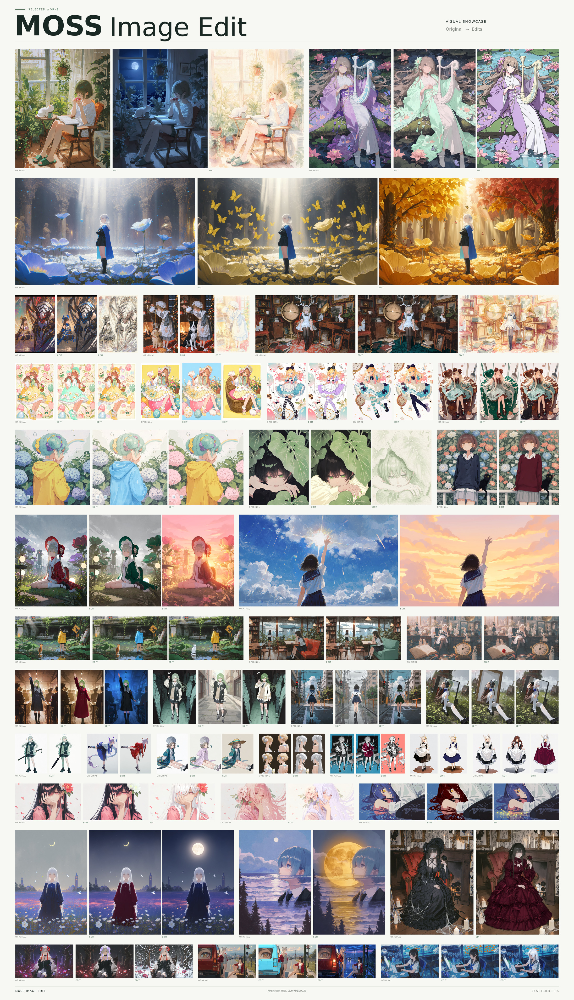
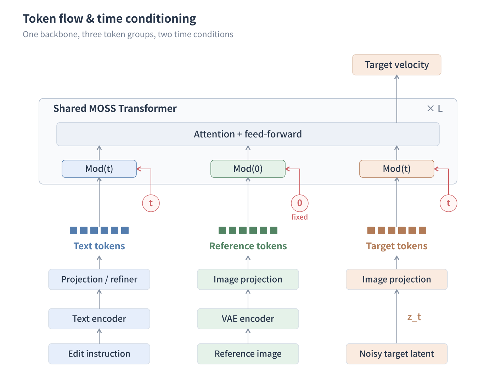
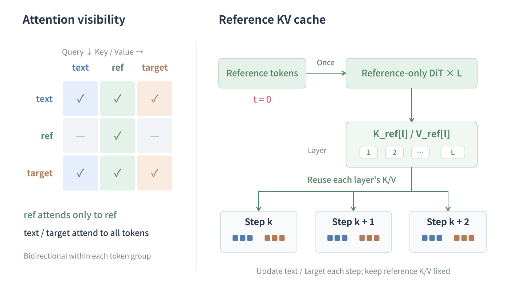

<p align="center">
  <a href="README.md">简体中文</a> &nbsp; · &nbsp; <strong>English</strong>
</p>

> [!NOTE]
> This repository primarily provides **training code for MOSS Image Edit**. For image-editing inference, visit [ComfyUI-Moss-Image-Edit](https://github.com/Chenkin-x/ComfyUI-Moss-Image-Edit/blob/main/README.en.md) for installation instructions and example workflows.

<p align="center">
  
</p>

<p align="center">
  <strong>Give your images a new expression.</strong><br>
  MOSS Image Edit is an <strong>image-editing LoRA for MOSS-Image</strong>. Edit expressions, outfits, and scenes with text instructions, using one or multiple reference images.<br>
  The release contains LoRA weights and configuration and requires the MOSS-Image Base or SFT model.
</p>

<p align="center">
  <a href="#editing-showcase">Editing showcase</a>
  &nbsp; · &nbsp;
  <a href="#quick-start">Quick start</a>
  &nbsp; · &nbsp;
  <a href="#comfyui">ComfyUI</a>
  &nbsp; · &nbsp;
  <a href="#model-architecture">Model architecture</a>
</p>

## Editing showcase

Explore changes in color, outfits, lighting, seasons, and visual style. Each group starts with the original image, followed by its edits.

<p align="center">
  
</p>

| Describe the change | Start with an image | Combine references |
|:---|:---|:---|
| Use natural language to describe changes to expressions, clothing, or surroundings. | Use an existing image as the starting point and guide the edit with your instructions. | Combine people, outfits, and scenes using up to 4 reference images. |

## Quick start

Download the [MOSS Image Edit LoRA weights](https://huggingface.co/chinoll/Moss-Image-Edit) together with either [MOSS-Image-Base](https://huggingface.co/OpenMOSS-Team/MOSS-Image-Base) or [MOSS-Image-SFT](https://huggingface.co/OpenMOSS-Team/MOSS-Image-SFT). **Both are supported; choose either one.** Follow the [ComfyUI guide](https://github.com/Chenkin-x/ComfyUI-Moss-Image-Edit/blob/main/README.en.md) to place the base model and LoRA and import a workflow.

Upload an image and describe the change, such as **“Change the background to a sunny beach, preserving the person.”** You can also provide multiple references and explain each image's role in your instruction.

## ComfyUI

**Upload a reference, describe the change, and generate.** Nodes are available in the dedicated [ComfyUI-Moss-Image-Edit](https://github.com/Chenkin-x/ComfyUI-Moss-Image-Edit) repository. Follow the [ComfyUI guide](https://github.com/Chenkin-x/ComfyUI-Moss-Image-Edit/blob/main/README.en.md) for installation and model placement, then download a workflow and drop it onto the canvas.

| Single-image editing | Multiple references |
|:---|:---|
| [Download single-reference workflow](https://github.com/Chenkin-x/ComfyUI-Moss-Image-Edit/blob/main/workflows/moss_edit_single_reference.json) | [Download multi-reference workflow](https://github.com/Chenkin-x/ComfyUI-Moss-Image-Edit/blob/main/workflows/moss_edit_multi_reference.json) |
| One reference image and an editing instruction. | Two references connected by default; extend to four. |

The workflows include model loading, image inputs, editing, and saving. Adjust output dimensions, seed, and sampling settings as needed.

## Model architecture

**Keep reference information available throughout editing and reuse its computation.** A reference branch extends the MOSS backbone. Separate time conditioning and attention visibility make this branch a cacheable source of visual context.

<p align="center">
  
</p>

**Different inputs, different times.** Tokens are ordered as `[text, ref, target]`. Reference images remain free of noise and use a fixed time of `0`; text and the noisy target use the current denoising time `t`. Both branches share backbone weights, with their respective time conditions producing shift, scale, and gate parameters.

<p align="center">
  
</p>

**References attend to one another; the editing branch reads all inputs.** Reference queries attend only to reference keys and values, allowing multiple reference images to interact. Text and target queries can attend to every token. Reference features at each layer therefore depend only on the reference images, while the editing branch uses both textual and visual information.

**Build once, reuse at every step.** Before sampling, the reference branch passes through all Transformer layers and stores each layer's `K_ref / V_ref`. Each subsequent denoising step updates only text/target tokens and reads the cache for the corresponding layer. Since the reference branch does not depend on text, the same cache also serves both positive and negative CFG branches, reducing repeated computation.

## Credits

- Thanks to [@niangao2331](https://github.com/niangao2331) for contributing part of the image-editing data used in this project.
- Thanks to the [ConceptEdit team](https://huggingface.co/inclusionAI) for releasing the [ConceptEdit-12M dataset](https://huggingface.co/datasets/inclusionAI/ConceptEdit-12M) for single-image editing.
- Thanks to [@onglon114514](https://github.com/onglon114514) for generating the showcase images.

## Citation

If you use this project's code or LoRA weights in your research, please cite:

```bibtex
@misc{chinoll2026mossimageedit,
  author = {chinoll},
  title  = {{MOSS Image Edit}},
  year   = {2026},
  url    = {https://github.com/Chenkin-x/Moss-Image-Edit}
}
```

---

<p align="center">
  <sub>Built on MOSS-Image · Repository code licensed under <a href="LICENSE">GNU GPLv3</a><br>
  Base models and third-party dependencies retain their respective licenses.</sub>
</p>
