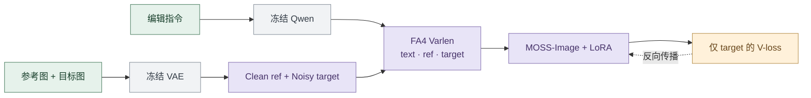

<picture>
  <source media="(prefers-color-scheme: dark)" srcset="assets/readme-dark.svg">
  
</picture>

<p align="center">
  <strong>一张参考图，一句指令，训练你自己的图像编辑 LoRA。</strong><br>
  <sub>基于 MOSS-Image，提供数据读取、多卡微调、定期采样与独立推理。</sub>
</p>

<p align="center">
  <a href="EDIT_LORA.md">使用指南</a>
  &nbsp; · &nbsp;
  <a href="configs/train.json">训练配置</a>
  &nbsp; · &nbsp;
  <a href="scripts/sample_edit_lora.py">编辑推理</a>
  &nbsp; · &nbsp;
  <a href="LICENSE">GPLv3</a>
</p>

<p align="center">
  <code>LoRA</code> &nbsp; <code>FA4 Varlen</code> &nbsp; <code>ZeRO-2</code> &nbsp; <code>Muon</code>
</p>

<br>

<table>
  <tr>
    <td width="33%" valign="top">
      <strong>01 · 保留图像上下文</strong><br><br>
      参考图保持干净状态，结合编辑指令预测目标图像。
    </td>
    <td width="33%" valign="top">
      <strong>02 · 混合不同尺寸</strong><br><br>
      FA4 变长注意力打包图像与文本，训练不需要按图像尺寸分桶。
    </td>
    <td width="33%" valign="top">
      <strong>03 · 训练中查看效果</strong><br><br>
      定期生成参考图、编辑结果、目标图对比，保存到本地并记录到 W&amp;B。
    </td>
  </tr>
</table>

## 开始训练

准备完整的本地 MOSS-Image 模型目录，包含 `pipeline_moss_image.py`、`transformer/`、`text_encoder/`、`tokenizer/`、`vae/` 和 `scheduler/`。

```bash
python -m pip install -r requirements.txt

# 为 DeepSpeed 0.19.6 的 Muon / ZeRO-2 加入 RMS matching
python scripts/patch_deepspeed_muon.py
```

编辑 [`configs/train.json`](configs/train.json) 中的模型与数据路径。相对路径以配置文件所在目录为基准。

```bash
# 为 NOOB2 Lance 与已完成转换的 ConceptEdit TAR 建立索引
python scripts/index_edit_sources.py --config configs/train.json

# 4 卡训练：每卡 32，global batch 128
torchrun --standalone --nproc_per_node=4 \
  scripts/train_edit_zero2.py --config configs/train.json
```

默认从 NOOB2 固定随机抽取约 35.6 万对，与 ConceptEdit 按 `1:1` 概率混合采样。数据目录结构、续训及输出文件说明见 [使用指南](EDIT_LORA.md)。

## 试一次编辑

将 `--adapter` 指向训练输出的 LoRA 目录，提供一张参考图和编辑指令：

```bash
python scripts/sample_edit_lora.py \
  --config configs/train.json \
  --adapter output/moss-edit/checkpoint-00001000/adapter \
  --references reference.png \
  --prompt "Change the background to a sunny beach, preserving the person." \
  --height 256 --width 256 --steps 30 --cfg 4 \
  --output edited.png
```

输出包含编辑图像与记录提示词、随机种子、采样参数的 JSON。模型权重与数据由使用者单独准备。

## 默认训练配方

| 项目 | 配置 |
|:---|:---|
| 图像 | 长边上限 256，参考图与目标图使用同一缩放尺寸 |
| LoRA | Rank 64 · Alpha 64 |
| 批量 | 4 卡 × 32 × 累积 1 = **128** |
| 优化器 | DeepSpeed Muon · `match_rms_adamw` · ZeRO-2 |
| 学习率 | `1e-4` · 预热 1,000 步 · 随后恒定 |
| 训练目标 | Logit-normal 时间采样 · 仅 target 的速度 MSE |
| 显存设置 | 冻结文本编码器与 DiT Linear 使用 Quanto INT8；LoRA BF16；开启 gradient checkpointing |
| 训练长度 | 10,000 步，每 1,000 步保存与采样 |

<details>
<summary><strong>技术简览 · 从编辑样本到 LoRA 更新</strong></summary>



参考图始终使用 `t=0`，只读取参考图 token；text 与 target 可读取全部 token，并沿用 MOSS 的时间调制。不同样本通过 `cu_seqlens` 隔离。

当前 FA4 路径在前向使用 `mask_mod`，反向将相同的注意力区域拆成两次 FA4 计算，参考分支正常接收梯度。FA4 训练和采样均重新计算参考分支；另保留支持 ref KV cache 的 dense 推理路径，详见 [使用指南](EDIT_LORA.md)。

</details>

<details>
<summary><strong>已有 JSONL 数据？也可以先预编码再训练</strong></summary>

单独提供 [`configs/edit_lora.json`](configs/edit_lora.json) 与 [JSONL 样例](configs/edit_manifest.example.jsonl)。该入口使用单卡 / DDP 和 AdamW，支持多参考图；配置与当前 FA4 + ZeRO-2 入口独立。

```bash
python scripts/prepare_edit_cache.py --config configs/edit_lora.json
python scripts/train_edit_lora.py --config configs/edit_lora.json
```

</details>

---

<p align="center">
  <sub>Built on MOSS-Image · 本仓库代码采用 <a href="LICENSE">GNU GPLv3</a><br>
  底模与第三方依赖的许可证见各自项目。</sub>
</p>
