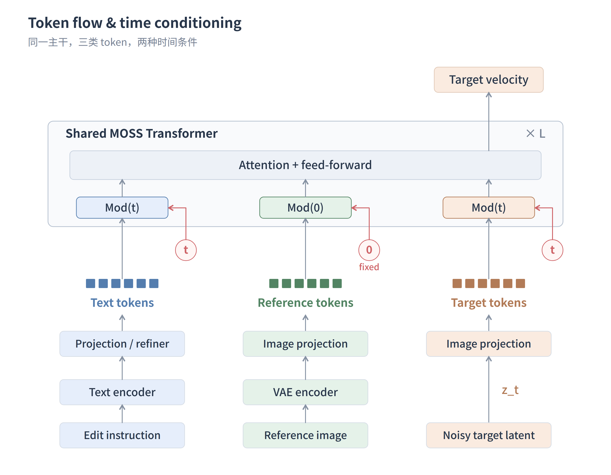
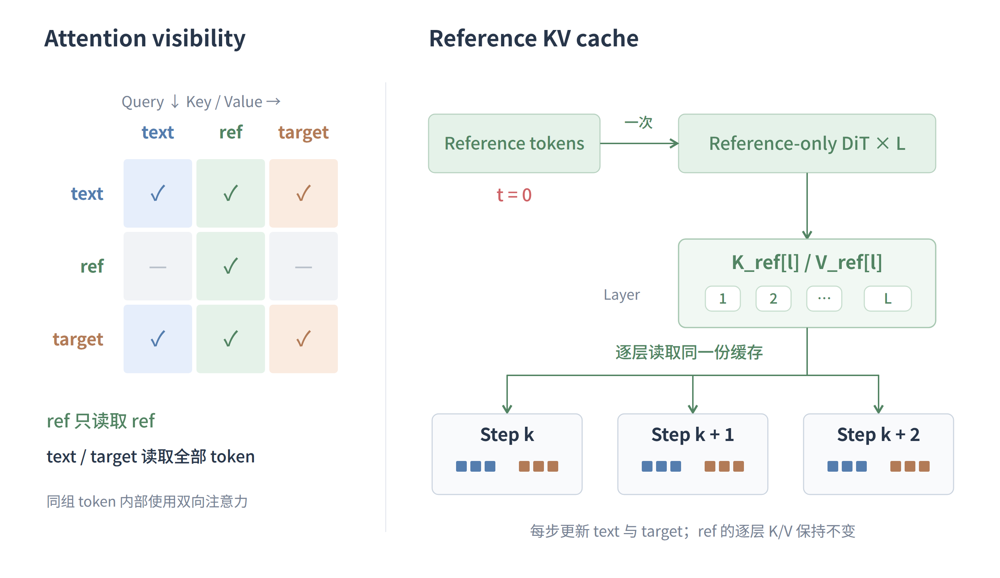

<picture>
  <source media="(prefers-color-scheme: dark)" srcset="assets/readme-dark.svg">
  
</picture>

<p align="center">
  <strong>为参考图构建一次 KV cache，在整个编辑过程中复用。</strong><br>
  <sub>基于 MOSS-Image，通过时间调制与注意力可见关系，让参考图成为可缓存的静态上下文。</sub>
</p>

<p align="center">
  <a href="#模型架构">模型架构</a>
  &nbsp; · &nbsp;
  <a href="docs/guide.md">使用指南</a>
  &nbsp; · &nbsp;
  <a href="configs/train.json">训练配置</a>
  &nbsp; · &nbsp;
  <a href="LICENSE">GPLv3</a>
</p>

## 模型架构

图像编辑中，参考图在整个去噪过程中保持不变。我们让它的**逐层特征也保持不变**：ref 使用固定时间调制，只读取 ref；text 与 target 沿用当前时间调制，并读取参考图提供的 K/V。

<p align="center">
  
</p>

<p align="center"><sub><a href="assets/kv-cache-architecture.png">查看高清图</a> · <a href="assets/kv-cache-architecture.svg">SVG 源图</a></sub></p>

三列依次是 `[text, ref, target]`，红色输入标出各自的调制时间。target 的输入是当前去噪步的加噪 latent。

**时间调制分离。** 两条数据流共享 MOSS 主干权重。ref 的时间固定为 `0`，通过时间网络得到固定的 shift、scale 和 gate；text 与 target 使用当前 `t`，随去噪步骤更新调制。

<p align="center">
  
</p>

<p align="center"><sub><a href="assets/reference-kv-cache.png">查看缓存示意图</a> · <a href="assets/reference-kv-cache.svg">SVG 源图</a></sub></p>

**注意力隔离。** token 顺序为 `[text, ref, target]`。ref 的 query 只访问 ref 的 key/value；text 和 target 的 query 可以访问全部 token。这样，ref 的隐藏状态只依赖参考图本身，text 与 target 仍然可以充分利用参考信息。

**逐层缓存复用。** 首次推理时，ref 独立经过所有 Transformer 层，为每层保存一组 `K_ref / V_ref`。后续每个去噪步只更新 text/target 分支，在第 `l` 层读取第 `l` 层的 ref cache。由于 ref 不依赖提示词，同一份缓存也可供 CFG 的正、负条件共用。

训练时参考分支正常参与反向传播，仅 target 计算速度预测损失；推理时构建并复用参考缓存。

## 试一次编辑

准备完整的本地 MOSS-Image 模型和训练得到的 LoRA，在 [`configs/infer.json`](configs/infer.json) 中设置底模路径。

```bash
python infer.py \
  --config configs/infer.json \
  --adapter output/moss-edit/checkpoint-00001000/adapter \
  --references reference.png \
  --prompt "Change the background to a sunny beach, preserving the person." \
  --height 256 --width 256 --steps 30 --cfg 4 \
  --output edited.png
```

该推理配置默认使用参考图 KV cache。输出包含编辑图像，以及记录提示词、随机种子和采样参数的 JSON。

## 训练自己的 LoRA

```bash
python -m pip install -r requirements.txt
python tools/patch_deepspeed_muon.py

# 修改 configs/train.json 中的底模、数据和输出路径
python prepare_data.py --config configs/train.json

# 4 卡 × 每卡 32 = global batch 128
torchrun --standalone --nproc_per_node=4 train.py --config configs/train.json
```

默认从 NOOB2 固定随机抽取约 35.6 万对，与 ConceptEdit 按 `1:1` 概率混合采样。不同尺寸的图像与不同长度的文本以变长序列训练。数据格式、续训及预编码入口见 [使用指南](docs/guide.md)。

| 项目 | 默认配置 |
|:---|:---|
| 图像 | 长边上限 256，参考图与目标图使用同一缩放尺寸 |
| LoRA | Rank 64 · Alpha 64 |
| 优化器 | DeepSpeed Muon · RMS matching · ZeRO-2 |
| 学习率 | `1e-4` · 预热 1,000 步 · 随后恒定 |
| 目标 | Logit-normal 时间采样 · 仅 target 的速度 MSE |
| 训练长度 | 10,000 步，每 1,000 步保存与采样 |

## 代码结构

```text
Moss-Image-Edit/
├── train.py              # 多卡训练入口
├── infer.py              # 编辑推理入口
├── prepare_data.py       # 数据索引入口
├── moss_edit/            # 模型、注意力、LoRA、数据、编码与共享采样逻辑
├── configs/              # 训练、推理与预编码配置
├── tools/                # Muon 补丁、预编码与缓存数据训练工具
├── docs/                 # 使用指南
└── assets/               # 架构图与横幅
```

从仓库根目录运行即可，无需安装项目本身。模型和数据需要单独准备。

---

<p align="center">
  <sub>Built on MOSS-Image · 本仓库代码采用 <a href="LICENSE">GNU GPLv3</a><br>
  底模与第三方依赖的许可证见各自项目。</sub>
</p>
